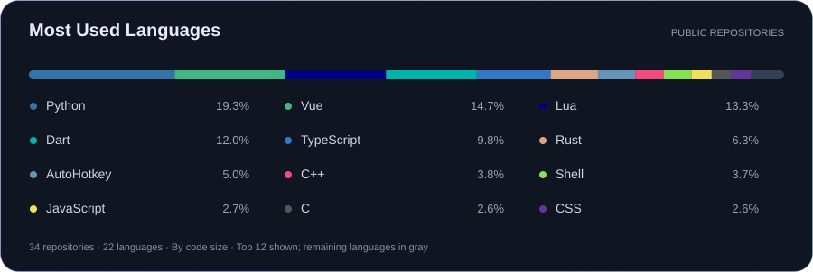

**AI student. Curious builder.**

I turn ideas into apps, tools, and connected experiences. 
Sometimes to solve a problem. Sometimes to make someone smile.

Xi’an University of Architecture and Technology · Building with AI since high school

  

[Projects](https://github.com/pu-007?tab=repositories) &nbsp; / &nbsp; [Blog](https://pu-007.github.io) &nbsp; / &nbsp; [Bilibili](https://space.bilibili.com/336609200)

 

## Made for someone.

<table>
<tr>
<td width="50%" valign="top">
<h3>SlGift</h3>
<b>A gift you can play.</b>

A personal gift turned into a pixel-art world. Floating islands, small surprises, and the freedom to choose.

Vue · JavaScript · Animation · Interaction design

<a href="https://github.com/pu-007/SlGift">Open the gift ↗</a>

</td>
<td width="50%" valign="top">
<h3>ShuangJu</h3>
<b>A gift that remembers.</b>

A Flutter app made as a personal gift. Favorite dramas, saved lines, personal notes, and a birthday surprise.

Dart · Flutter · TMDB · App design

<a href="https://github.com/pu-007/ShuangJu">Explore the app ↗</a>

</td>
</tr>
</table>

 

## From design to live.

**[Caimei Electronics](https://github.com/pu-007/caimeidz-offcial-website) · A real business, online.**

A company website carried from visual design to deployment and upkeep. 
SVG motion, responsive layouts, image and font optimization, scripted releases, and Caddy-managed HTTPS.

Vue · TypeScript · GSAP · Linux · Caddy · Web operations

[Visit the website ↗](https://sxcmdz.cn)

 

## Learn it. Make it clear.

**[MitoclearTeaching](https://github.com/pu-007/MitoclearTeaching) · See how cells divide.** 
A high-school AI-assisted project: interactive mitosis lessons, simulations, and Canvas charts.

**[C / C++ Study Guide](https://github.com/pu-007/xauat-c-and-cpp-final-exam) · Study with a plan.** 
AI-assisted exam materials, clear learning paths, runnable examples, and code checks.

**[Algorithm Practice](https://github.com/pu-007/lanqiao-cpp-b-journey) · Build the foundations.** 
An ongoing journey through C++, algorithms, and problem solving.

Use AI to explore. Run the code. Check the answer. Understand why.

 

## Make the tools fit.

| Focus | Projects | What I build |
| :--- | :--- | :--- |
| **A workspace of my own.** | [dotfiles](https://github.com/pu-007/dotfiles) + [WOTS](https://github.com/pu-007/wots) | Zsh, Neovim, Yazi, package hooks, and system settings. A Rust engine keeps configurations in sync across Arch Linux, WSL, and Windows. |
| **Keep hands on keys.** | [NeoCapsLockX](https://github.com/pu-007/NeoCapsLockX) + [im-select-ahk.nvim](https://github.com/pu-007/im-select-ahk.nvim) | Keyboard layers, window and mouse control, and input-method switching. AutoHotkey, Lua, and Windows APIs working together. |
| **Preview in place.** | [quicklook.yazi](https://github.com/pu-007/quicklook.yazi) | Windows QuickLook from Yazi in WSL. Lua, PowerShell, and cross-system path handling. |
| **Connect words to actions.** | [oxa-server](https://github.com/pu-007/oxa-server) + [xiaopilot](https://github.com/pu-007/xiaopilot) | Voice-command extensions, Python actions, MQTT PC control, and Wake-on-LAN. |

 

## Across the stack.

**Frontend & apps** — Layout, motion, and interaction. 
**Backend & systems** — Services, scripts, and integration. 
**Linux & operations** — Terminal workflows, deployment, and maintenance. 
**Smart home & IoT** — Voice, messages, and connected devices. 
**Applied AI** — Fast experiments, checked results, and practical use.

 

  

  
Also in the mix: AutoHotkey · PowerShell · Zsh · MQTT · Caddy

 

## Ideas I'm growing.

**Qixin · A home that cares.** 
A design study connecting smart homes with emotional support. Context, personal memory, and user choice. 
System design and offline flow checks so far. Real-home testing is a next step.

**AI, anywhere · Help where it matters.** 
Exploring AI across apps, devices, and daily routines.

**Useful tools · Made to be shared.** 
Taking small experiments further, with open tools others can use.

 

## Languages I build with.

<picture>
  <source media="(max-width: 600px)" srcset="./assets/top-langs-mobile.svg" />
  
</picture>

Language share reflects code size, not skill level.

---

### Stay curious. Build with care.

Open to internships and thoughtful collaborations. 
Applied AI · Software engineering · Connected devices

 

[Explore my work ↗](https://github.com/pu-007?tab=repositories)

